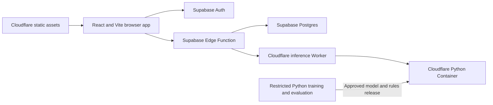

# Project FYM Architecture

The product requirements document is in the local research workspace under `Docs/`.

Project FYM is a research prototype for screening acute malnutrition in children under five in Kenya. React and Vite provide the browser interface, Supabase provides authentication and the backend API, and Cloudflare hosts the frontend and Python inference runtime. KDHS data clearance is complete. The cleaned, processed KDHS dataset is the source for model development, evaluation, and research workflow verification in the approved environment. The hosted app processes inputs on demand.

## Components

| Component | Responsibility |
| --- | --- |
| React and Vite in `Frontend/` | Collect screening inputs, optional clinical findings, and medication context. Present predicted malnutrition risk, clinical priority, nutritional findings, recommendations, and the research disclaimer. Keep case inputs in browser memory for the current session. |
| Cloudflare Workers Static Assets | Serve the Vite build from `Frontend/dist` over HTTPS. Enable single-page application fallback for client routes. |
| Supabase Auth | Sign in invited research reviewers and demo users. The browser uses a Supabase publishable key and sends the signed-in user's access token to the API. |
| Supabase Edge Function | Expose `POST /functions/v1/assess`. Verify the user token and demo access, validate the request, apply rate limits, and call the inference gateway. Return a versioned response with `Cache-Control: no-store`. |
| Supabase Postgres | Store demo membership and published release metadata, with migrations and row-level security. A release identifies the model, feature schema, decision policy, and approved rule bundle. |
| Cloudflare Worker and Container | The Worker authenticates the Supabase service call and forwards it through a Container binding. The Python Container loads the frozen Random Forest pipeline and approved rules, evaluates the case, and returns structured results. |
| Python research pipeline in `Backend/` | Build cohorts, train, evaluate, and package approved artifacts. Keep training inputs and row-level outputs in the approved research environment. |

## Assessment flow

1. The frontend submits a versioned request with `screeningInputs`, optional `clinicalInputs`, and optional `medicationContext`. The API accepts recognized fields and codes only. For research verification, populate screening inputs from the approved processed KDHS dataset. The processed model table supplies screening predictors and outcome labels for evaluation. Clinical findings and medication context require separately approved inputs when those fields are unavailable.
2. The Edge Function checks the user's demo membership and resolves the active release. It forwards the request and release identifier to the inference Worker using a dedicated server-to-server credential. The Worker rejects unauthenticated calls before forwarding to the Container.
3. Python applies the frozen preprocessing pipeline to the allowed interview-based predictors and returns the predicted class and model scores for Normal, MAM, and SAM. Clinical measurements, haemoglobin, target labels, and split identifiers are excluded from the prediction schema.
4. The clinical rules evaluate eligible measurements and findings independently. Insufficient evidence produces an assessment-pending result. A model score cannot confirm a clinical classification or override an escalation.
5. The pharmaceutical rules use the clinical result, comorbidities, and medication context. The approved rule bundle covers oral ferrous sulphate, zinc, amoxicillin, vitamin A, and oral rehydration salts. Results include the triggering rule, rationale, and approved next step. Escalation takes precedence.
6. The API returns `screening`, `clinicalAssessment`, `researchDisclaimer`, `pharmacyGuidance`, and `versions`. A transient inference failure returns a retryable error. The UI distinguishes an unavailable result from an assessment pending because of missing information.

## Data and access

- Store demo access and release metadata in Postgres. Apply row-level security to API-exposed tables and use caller-scoped database access where possible. Restrict release changes to authorized maintainers.
- Keep case payloads and results out of Postgres, application logs, analytics, and caches. Log request IDs, release versions, status codes, and timing without request or response bodies.
- Give preview and production separate Supabase projects and Cloudflare environments. Scope allowed frontend origins and Auth redirect URLs per environment. Store the inference credential in Supabase and Cloudflare secrets. Vite receives only public configuration, including the Supabase URL and publishable key.
- Exclude raw KDHS, derived records, and split identifiers from Git, preview builds, static assets, and inference images. Treat the Markdown copies in `Docs/` as having the same access restrictions as their source datasets. Use a narrow frontend build directory and inference image context. Confirm that the clearance covers processing KDHS-derived case inputs in Supabase and Cloudflare before sending those inputs to the hosted app. Confirm that the model artifact may be shared with the hosting provider before releasing it.

## Model and rule releases

Train and evaluate the Random Forest in the approved environment using the PRD's group-held-out protocol. Package the fitted preprocessing and estimator together in a pinned Python environment. Each release includes the feature schema, class order, decision policy, artifact checksum, evaluation summary, and a versioned rule bundle. Only load artifacts produced by the project's own build pipeline.

Use parity fixtures to compare local and container predictions. Run rule fixtures for boundaries, missing or conflicting information, alert precedence, and all five pharmacy groups. Publish aggregate evaluation results only where permitted. Keep the final survey holdout outside hosted environments.

## Deployment

1. Use the existing Vite scaffold. In Cloudflare CI, run `npm ci`, lint, and build from `Frontend/`. Deploy only `dist/` to the static-assets Worker.
2. Apply Supabase migrations and deploy the Edge Function to the matching environment. Configure invited reviewers, Auth redirects, allowed origins, and inference credentials.
3. Build the Python image with only the reviewed runtime files, model, and rules. Deploy the gateway Worker and Container through Wrangler. Cloudflare Containers require a Workers Paid plan. Confirm plan access and benchmark cold starts, memory, and request timeouts in preview before promoting. [Cloudflare Containers](https://developers.cloudflare.com/containers/)
4. Deploy and verify the compute release before activating it in Supabase. Smoke-test sign-in, rejected unauthorized requests, a case from the cleaned KDHS dataset in the approved environment, a case with missing clinical inputs, and an unavailable-inference response. Keep the previous compatible release deployable and restore its compute version and matching Supabase release metadata together if rollback is needed.

The first implementation includes the React and Vite workspace, a Python screening API and training pipeline, Supabase access and API code, and Cloudflare deployment configuration. Follow the [local backend setup](Backend/README.md) or the [preview deployment guide](deploy/README.md). The clinical rules are available for research testing and require clinical validation. Pharmacy guidance stays pending rule review. Use a hosted Supabase preview for KDHS-derived cases only if covered by the clearance.

## Platform references

- [Cloudflare Workers Static Assets](https://developers.cloudflare.com/workers/static-assets/)
- [Supabase Edge Function authentication](https://supabase.com/docs/guides/functions/auth)
- [Supabase data security](https://supabase.com/docs/guides/database/secure-data)
